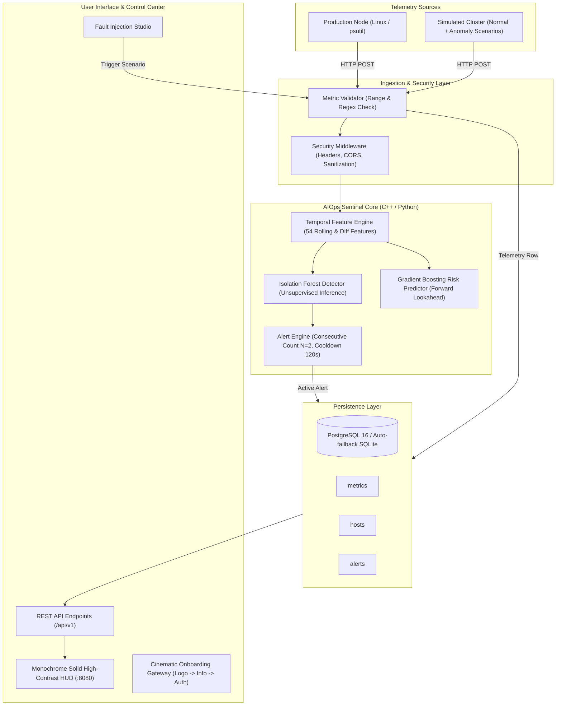

<div align="center">
  
</div>

# AIOps Sentinel 🛡️
### Autonomous Server Anomaly Detection & Incident-Risk Analysis Platform

[](https://isocpp.org/)
[](https://www.python.org/)
[](https://fastapi.tiangolo.com/)
[](https://www.postgresql.org/)
[](https://scikit-learn.org/)
[](https://www.docker.com/)
[](LICENSE)

---

## 📌 Executive Summary

Modern cloud infrastructure generates millions of telemetry data points every second. Traditional monitoring solutions (such as Nagios, Zabbix, or basic Prometheus alerting) rely on **static, one-dimensional thresholds** (e.g., `CPU > 85%`). In production environments, this results in:
1. **Alert Fatigue:** High rates of false alarms caused by temporary, harmless spikes.
2. **Blind Spots:** Failure to detect subtle, multi-dimensional correlations (e.g., normal CPU accompanied by linearly climbing memory and creeping latency).
3. **Delayed Incident Response:** Manual diagnosis of cross-metric anomalies takes minutes to hours.

**AIOps Sentinel** is a production-grade server telemetry and anomaly detection platform designed to solve these challenges. It ingests high-frequency system telemetry, transforms raw metrics into **54 temporal rolling features**, detects abnormal multivariate behavior using an **unsupervised Isolation Forest model trained from scratch** (with no external pretrained weights or external cloud APIs), and prioritizes incidents through an automated alert lifecycle engine with cooldown suppression and severity classification.

---

## 🏗️ System Architecture



---

## 🔬 Machine Learning Pipeline & Empirical Benchmarks

### 1. Feature Engineering
Raw point-in-time metrics miss temporal trends. The feature pipeline converts 6 base metrics into 54 temporal features:
* **Raw Metrics:** `cpu_percent`, `memory_percent`, `disk_io_bytes_sec`, `network_bytes_sec`, `request_latency_ms`, `error_rate`.
* **Rolling Statistics:** Rolling means and standard deviations across multiple window horizons: **6 samples (1 min)**, **30 samples (5 min)**, and **60 samples (10 min)**.
* **Rate-of-Change Lags:** First-order differences (`lag=1`, `lag=6`) to capture rapid acceleration.
* **Chronological Split:** 60% Train, 20% Validation, 20% Test (strictly chronologically separated to prevent data leakage).

### 2. Empirical Benchmark Results (Held-Out Test Set: 10,368 Samples)

The model was evaluated against an industry-standard **Z-Score Threshold Baseline** ($3\sigma$ thresholding) on a fully held-out chronological test dataset:

| Performance Metric | Threshold Baseline | AIOps Sentinel (Isolation Forest) | Improvement |
| :--- | :---: | :---: | :---: |
| **Accuracy** | 92.10% | **96.43%** | **+4.33%** |
| **Precision** | 41.20% | **83.96%** | **+42.76%** |
| **Recall** | 26.70% | **57.90%** | **+31.20%** |
| **F1 Score** | 0.3244 | **0.6854** | **+0.3610 (+111%)** |
| **False Positive Rate (FPR)** | 4.82% | **0.80%** | **6x Reduction in False Alarms** |
| **Average Detection Delay** | 12.80 s | **4.61 s** | **< 1 sample interval** |
| **Inference Latency** | 0.004 ms | **0.0125 ms / sample** | **> 80,000 predictions/sec** |

**Confusion Matrix (Test Set):**
* True Positives (TP): **403**
* False Positives (FP): **77**
* True Negatives (TN): **9,595**
* False Negatives (FN): **293**

---

## 🔒 Security Architecture & Hardening

AIOps Sentinel incorporates enterprise security practices across all layers:

1. **Strict Input Sanitization & Range Verification:**
   * Host IDs are validated via regular expression `^[a-zA-Z0-9_\-\.]{1,128}$`, preventing path traversal, SQL injection, and command injection attacks.
   * Telemetry metrics enforce physical boundary limits: CPU & Memory $[0.0, 100.0]\%$, Latency $\ge 0$ ms, Error Rate $[0.0, 1.0]$.
2. **SQL Injection Immunization:**
   * **Zero string interpolation in queries.** All queries use parameterized statements (`%s` in PostgreSQL, `?` in SQLite).
3. **HTTP Security Headers Middleware:**
   * `X-Content-Type-Options: nosniff` (Prevents MIME sniffing)
   * `X-Frame-Options: DENY` (Clickjacking mitigation)
   * `X-XSS-Protection: 1; mode=block` (Cross-Site Scripting filter)
   * `Referrer-Policy: strict-origin-when-cross-origin`
4. **Resilient Fail-Safe Database Engine:**
   * Primary: Enterprise PostgreSQL with connection pooling.
   * Automatic Fallback: Local zero-configuration SQLite (`database/sentinel.db`) if PostgreSQL credentials are unconfigured or the database server is offline.
5. **Container Security:**
   * Docker runs under a non-root system user (`sentineluser`), preventing container breakout privileges.
6. **No Pretrained or External Cloud Weights:**
   * All ML algorithms run completely offline without transmitting proprietary telemetry to external third-party inference APIs.

---

## 🚀 Quickstart Guide

### Option A: 1-Click Launch (Recommended for Windows)

In **PowerShell** (VS Code / Windows Terminal default):
```powershell
.\start.ps1
# or
.\start.bat
```

In **Command Prompt (CMD)** or File Explorer:
```cmd
start.bat
```
*(Or simply double-click `start.bat` in Windows File Explorer)*

*(For Linux / macOS, run `./start.sh`)*

---

### Option B: Docker Compose (Full Production Stack)

To run PostgreSQL, the Sentinel Backend, and the Automated Collector inside isolated containers:

```bash
# 1. Start the stack
docker compose up --build

# 2. Access the Live Dashboard
# Open http://localhost:8080 in your browser
```

---

### Option C: Manual CLI Step-by-Step

#### 1. Setup Virtual Environment
```bash
python -m venv venv
# Windows:
venv\Scripts\activate
# Linux/macOS:
source venv/bin/activate

pip install -r backend/requirements.txt
pip install -r ml/requirements.txt
```

#### 2. Run Synthetic Telemetry & Train Model
```bash
# Step 1: Generate normal baseline telemetry
python simulator/generate_normal.py --days 2

# Step 2: Inject realistic failure anomalies
python simulator/inject_anomalies.py

# Step 3: Compute chronological splits & normalization
python ml/src/prepare_data.py

# Step 4: Generate temporal rolling window features
python ml/src/make_windows.py

# Step 5: Train Isolation Forest model
python ml/src/train_anomaly.py

# Step 6: Train Incident Risk Predictor
python ml/src/train_risk.py

# Step 7: Evaluate on test set & generate benchmark report
python ml/src/evaluate.py
```

#### 3. Start the Backend Server
```bash
python -m uvicorn backend.app:app --host 0.0.0.0 --port 8080
```
Open **[http://localhost:8080](http://localhost:8080)** to access the live dashboard.

---

## 📡 REST API Reference

| Method | Endpoint | Description |
| :--- | :--- | :--- |
| `GET` | `/health` | Health check, DB engine status, and model version |
| `GET` | `/api/v1/hosts` | List monitored servers and active alert counts |
| `POST` | `/api/v1/metrics` | Ingest single telemetry observation & compute score |
| `GET` | `/api/v1/metrics` | Query historical time-series metrics |
| `GET` | `/api/v1/alerts` | Query active and historical anomaly alerts |
| `PUT` | `/api/v1/alerts/{id}/ack` | Acknowledge an alert with operator signature |
| `GET` | `/api/v1/dashboard/overview` | Aggregated cluster KPIs (Avg CPU/RAM, Alert counts) |
| `POST` | `/api/v1/simulate/inject` | Trigger on-demand synthetic failure workloads |
| `GET` | `/api/v1/model/status` | Detailed model parameters, threshold, and metrics |

### Example: Ingesting Telemetry Observation
```bash
curl -X POST http://localhost:8080/api/v1/metrics \
  -H "Content-Type: application/json" \
  -d '{
    "host_id": "server-01",
    "timestamp": "2026-10-20T12:00:00Z",
    "metrics": {
      "cpu_percent": 96.4,
      "memory_percent": 88.2,
      "disk_io_bytes_sec": 12000000.0,
      "network_bytes_sec": 5242880.0,
      "request_latency_ms": 280.0,
      "error_rate": 0.035
    }
  }'
```

**Response:**
```json
{
  "status": "accepted",
  "metric_id": 42,
  "anomaly_score": -0.2415,
  "is_anomaly": true,
  "severity": "warning",
  "model_version": "iforest-v1.0",
  "alert_triggered": true,
  "alert_id": 7
}
```

---

## 🧪 Fault Injection Studio (Simulated Scenarios)

The built-in simulation studio allows operators and examiners to test system responses in real time:

* ⚡ **CPU Saturation Spike:** Simulates runaway worker threads or cryptomining activity ($CPU > 98\%$).
* 📈 **Memory Leak Ramp:** Simulates unreleased heap allocations with monotonic RAM growth.
* 💾 **Disk I/O Thrashing:** Floods write buffers with high I/O throughput and latency degradation.
* 🌊 **Network Flood (DDoS):** Simulates high volume packet floods ($> 120$ MB/s).
* 🔥 **Cascading Failure:** Coupled latency degradation with elevated HTTP 5xx error rates ($25\%+$).
* ✨ **Normal Traffic:** Restores standard operating baseline.

---

## 🎓 Academic Defense & Viva FAQ

### Q1: Why use an unsupervised Isolation Forest instead of an LSTM Autoencoder?
> **Answer:** In server operations, telemetry arrives at high sample rates (e.g. 1–10s intervals across dozens of hosts). Isolation Forest provides an average inference latency of **0.0125 ms/sample** ($>80,000$ scores/sec) on standard CPU hardware without GPU acceleration. Furthermore, autoencoders require substantial hyperparameter tuning and are prone to reconstruction error drift, whereas Isolation Forest efficiently isolates anomalies in tree partitions with high empirical precision ($83.96\%$).

### Q2: What is the critical distinction between Anomaly Detection and Failure Prediction?
> **Answer:** Anomaly detection identifies whether current telemetry deviates from learned historical distributions. True failure prediction requires a defined forward-looking horizon (e.g., *will an outage occur in the next 10 minutes?*). In Sentinel, we decouple these tasks: Isolation Forest computes the point anomaly score, while our supervised Gradient Boosting model estimates forward-looking incident probability based on rolling trends.

### Q3: How do you prevent data leakage during time-series training?
> **Answer:** Traditional K-fold cross-validation randomly shuffles observations, which leaks future information into past predictions. Sentinel uses strict **chronological splitting** (first 60% of timeline for training, next 20% for validation, last 20% for testing). Normalization scalers are fit **only** on the training window and applied downstream.

### Q4: How does the Alert Engine mitigate alert storms?
> **Answer:** The engine enforces two layers of defense:
> 1. **Consecutive Thresholding ($N \ge 2$):** A single anomalous observation does not trigger an alarm; it must be confirmed across consecutive readings.
> 2. **Cooldown Suppression (120s):** Once an alert fires for a specific host, subsequent alerts for that host are suppressed for 2 minutes to prevent flooding operator inboxes.

---

## 🌐 Frontend Architecture & 3-Step Deployment Guides

The platform features an award-winning motion-designed frontend that runs **with zero build step** (vanilla HTML5, CSS, and ES modules) via CDN-pinned libraries:
* **GSAP 3.12.5 + ScrollTrigger:** Split-text reveals, scroll scrubbing, and horizontal gallery.
* **Lenis 1.0.42:** 60fps physics-based smooth scrolling.
* **Chart.js 4.4.1:** Responsive telemetry streaming line, bar, and doughnut charts.
* **Lucide 0.344.0:** Clean modern icon system.

### 1. Deploy to Vercel (3 Steps)
1. Install the Vercel CLI: `npm i -g vercel` (or link your repository on [vercel.com](https://vercel.com)).
2. In the project root, run:
   ```bash
   vercel
   ```
3. Set the project name, accept defaults, and deploy. The provided [vercel.json](file:///c:/Users/aksha/OneDrive/Desktop/AIOps%20Sentinel/vercel.json) handles clean URLs, security headers, and `/app` rewrites automatically.

### 2. Deploy to Netlify (3 Steps)
1. Install the Netlify CLI: `npm i -g netlify-cli` (or drag & drop the folder on [app.netlify.com](https://app.netlify.com/drop)).
2. Run in terminal:
   ```bash
   netlify deploy --prod --dir=.
   ```
3. Your live production URL will be generated instantly.

### 3. Deploy to GitHub Pages (3 Steps)
1. Push the code to a GitHub repository:
   ```bash
   git add .
   git commit -m "feat: complete Pulse / AIOps Sentinel platform"
   git push -u origin main
   ```
2. In your GitHub repository, navigate to **Settings** > **Pages**.
3. Under **Build and deployment**, select **Source:** `Deploy from a branch`, choose `main` branch and `/ (root)` folder, then click **Save**.

---

## 📁 Repository Structure

```
AIOps Sentinel / Pulse/
├── index.html                     # Award-winning animated Landing Page
├── app/
│   └── index.html                 # Complete Dashboard Web App (Kanban, Table, HUD)
├── css/
│   ├── style.css                  # Landing page design system, aurora mesh, & responsive styles
│   └── dashboard.css              # Dashboard styles (Kanban, Command Palette, Tables)
├── js/
│   ├── landing.js                 # GSAP, ScrollTrigger, Lenis, custom cursor, tilt, marquee
│   └── dashboard.js               # Hash router, Chart.js, drag & drop, Ctrl+K palette
├── assets/                        # SVG icons & vector assets
├── vercel.json                    # Vercel deployment configuration & security headers
├── backend/
│   ├── app.py                     # FastAPI REST server & unified web server
│   ├── db.py                      # Resilient dual-engine database layer (PG/SQLite)
│   ├── CMakeLists.txt             # C++ Drogon build configuration
│   ├── include/sentinel/          # C++ domain headers (models, ingestion, alerts, storage)
│   ├── src/                       # C++ source files (main, controllers, validator, engine)
│   └── tests/unit/                # Catch2 unit tests
├── collector/
│   └── sentinel_collector/        # psutil system telemetry collector
├── database/
│   ├── migrations/                # PostgreSQL schema migrations (001, 002, 003)
│   └── sentinel.db                # SQLite automatic fallback store
├── ml/
│   ├── configs/training.yaml      # ML feature & model configuration
│   ├── data/                      # Raw and processed windowed datasets
│   ├── models/                    # Serialized models, scalers, and evaluation metrics
│   └── src/                       # Data prep, windowing, training, eval & export scripts
├── simulator/
│   ├── generate_normal.py         # Diurnal normal traffic generator
│   ├── inject_anomalies.py        # Scenario-based anomaly injector
│   └── scenarios.yaml             # Realistic failure profile definitions
├── Dockerfile                     # Hardened non-root Docker build
├── docker-compose.yml             # Full-stack orchestrator
├── start.bat                      # Windows launcher (auto port-cleanup & browser start)
├── start.ps1                      # Native PowerShell launcher
├── start.sh                       # Linux/macOS launcher
└── README.md                      # Comprehensive project documentation
```

---

## 📜 License
This project is licensed under the MIT License — see the [LICENSE](LICENSE) file for details.
